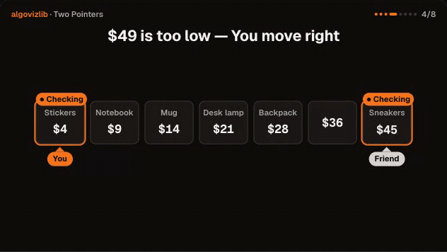
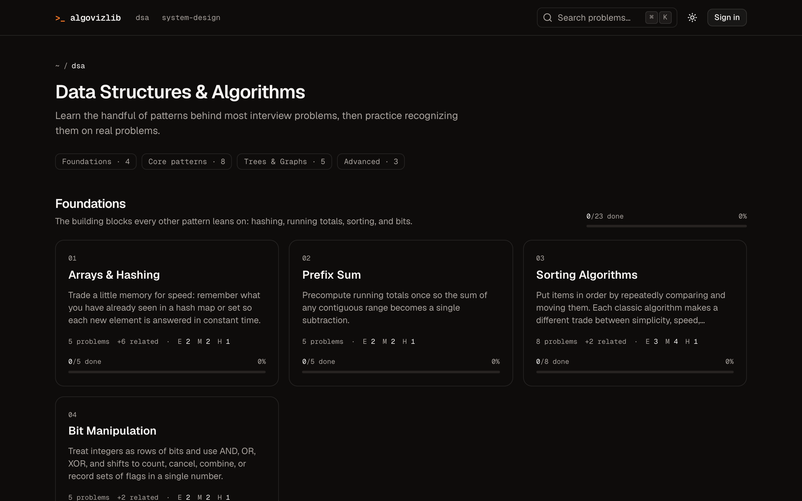
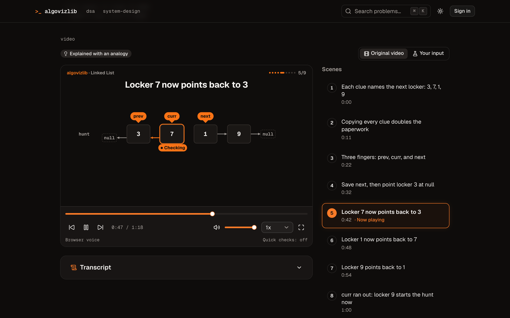

# algovizlib

algovizlib teaches algorithm patterns with short animated videos. It covers 103 problems in 20 patterns (two pointers,
sliding window, dynamic programming, graphs, and the rest), and every problem has a video that explains the approach
through a concrete example, not line by line through code. Each video is generated from the algorithm's own trace, so
every pointer, comparison, and table cell on screen is what the real algorithm does on that input, checked by a
validator before it ships. Learners can pause on quick checks, step through their own input, track progress, and get a
review queue of what to revisit.

**Live: [algovizlib.vercel.app](https://algovizlib.vercel.app)**



| Patterns                                              | A problem's video                                            |
| ----------------------------------------------------- | ------------------------------------------------------------ |
|  |  |

## Features

- **103 animated explanations.** Each is 6–10 scenes, told either through the problem's own story (a staircase, a
  street of houses) or through one analogy for abstract problems (a price-sorted shelf for two pointers). There are 47
  visual primitives, including bars, linked lists, trees, grids, heaps, DP tables, tries, union-find forests, and
  timelines.
- **System design as incident replays.** "Why was the customer charged twice?" replays a lost answer and a retry
  message by message in a deterministic, seeded simulation, then replays the fix (an idempotency key, claimed first,
  stored with the result, forwarded to the payment provider). The fix is checked against every single and double lost message on both
  hops. "Is one server enough?" estimates the peak, measures where one server saturates, and only then adds a load
  balancer and a second server (the validator enforces that order). "One slow server takes everyone down" follows
  requests through a round-robin balancer to a degraded server, then replays the incident with least-outstanding
  routing and health checks. "I posted a comment and it vanished" follows one user's comment from the primary
  database through a lagging replication stream to a read replica, shows how often reads come back stale as lag grows,
  then replays it with read-your-writes and measures the load the fix moves back to the primary. Learners can change
  the failures, timings, safeguards, traffic, servers, and replication lag and replay their own scenario. The rest of the curriculum is planned.
- **A curated catalog.** 20 patterns in four groups, 4–8 problems each with easy, medium, and hard. Statements are
  original, examples are machine-checked, hints are progressive, and the approach stays hidden behind a toggle.
- **Quick checks.** 89 of the videos pause before a few key steps and ask what happens next (220 questions). Questions
  come from the trace, so the right answer is always the algorithm's own.
- **Try your own input.** On 70 problems the learner can type an input (or press Random), and the browser runs the same
  trace, builds and validates a walkthrough, and plays it. No server is involved.
- **Progress and a review queue.** Each problem has a status (Not started, Learning, or Done) and videos resume where
  they stopped. `/review` lists what to revisit: missed quick checks, Done problems on spaced intervals (3, 7, 21, 60
  days), unfinished videos, and stale Learning problems.
- **Optional accounts.** Everything works for guests in the browser. Signing in with GitHub or Google syncs progress,
  answers, and the review schedule, and merges the guest data on first sign-in.
- **Narration.** 18 videos have a recorded ElevenLabs voice-over stitched into one track, and the rest use the
  browser's speech synthesis. Captions and a transcript are always available.
- **Accessible and responsive.** Keyboard shortcuts, reduced motion, light and dark themes, text that stays readable
  in the player at phone width, and no axe violations on the main pages.

## Architecture at a glance

```
catalog problem ──► trace ──► storyboard ──► validator ──► Remotion player (in the browser)
```

A trace is a deterministic, instrumented solution that records every decision. A storyboard is typed data: scenes
with narration and visual elements, which bind to trace steps and take their values from them. The validator checks
the arithmetic, every pointer, and every structure against the trace. Storyboards were written by hand or generated
offline by a model; either way the same checks decide what ships. Catalog pages are statically prerendered, and
session, progress, and the review queue load in the browser.

Details, decisions, and the data model are in [docs/DESIGN.md](docs/DESIGN.md). The full working reference is
[CLAUDE.md](CLAUDE.md), covering conventions, how to add a pattern, problem, primitive, or video, and the roadmap.

## Tech stack

Next.js 16 (App Router, Cache Components) · React 19 · TypeScript (strict) · Tailwind CSS v4 · shadcn/ui · Remotion
Player · Zustand · Zod · Auth.js v5 · Prisma 7 + Postgres (Neon) · Vitest · Playwright + axe (browser checks) ·
ElevenLabs and ffmpeg (offline narration) · Vercel AI SDK (offline generation, and the optional tutor) · Vercel

## Testing

`pnpm test` runs **2,566 tests in 47 files** in about 15 seconds, with no network access. Among them:

- **321 catalog examples** are checked against 103 independent reference solutions (test-only code), using each
  problem's judge.
- **103 traces** are checked against the reference answers on every example that fits on screen.
- **103 storyboards** pass the schema and the trace validator, and mutated copies must fail.
- **852 scenes** are laid out at phone width. Values must fit their cards, pointers must not overlap, and nothing may
  run into the bottom panel. Literal font sizes are forbidden in the video code.
- **220 quick-check questions** are validated against their traces, and every word must be on screen.
- **70 "Try your own input" specs** run on seeded random inputs. Each must match the reference answer and build a
  walkthrough that validates and fits.
- **The system design simulation:** event order, seeding, and exact replays; the flagship's four replays against
  hand-computed outcomes; the fix against every single and paired lost message on both hops (0 double charges) and
  each safeguard shown necessary; validator mutations; and every "Your scenario" combination built, validated, and
  fitted to a phone.
- Auth, rate limits, account linking, progress merging, the review queue, the tutor's grounding and limits, and the
  narration pipeline. Postgres integration tests run against a local database.

Browser checks drive the built app at 375 px and 1280 px in both themes with axe. They run Chrome muted with a silent
speech fake, so nothing plays aloud. Lighthouse on the home, pattern, and problem pages scores 100 for accessibility,
best practices, and SEO on mobile and desktop.

## Running it locally

Requirements: Node.js 20+ and pnpm (`corepack enable pnpm`). Postgres is only needed for accounts.

```bash
pnpm install
pnpm dev            # http://localhost:3000
```

Guests never touch the database, so this is enough to browse every page and play every video. To try accounts:

```bash
brew install postgresql@16 && brew services start postgresql@16
createdb algovizlib_dev && createdb algovizlib_test
cp .env.example .env.local    # set DATABASE_URL, DATABASE_URL_TEST, and AUTH_SECRET (npx auth secret)
pnpm db:migrate
```

Locally, email and password sign-in is on, and verification links are printed to the server console. GitHub and
Google buttons appear once their `AUTH_*_ID` and `_SECRET` are set.

| Command                         | What it does                                                |
| ------------------------------- | ----------------------------------------------------------- |
| `pnpm dev` / `build` / `start`  | Develop, build (static prerender), serve the build          |
| `pnpm lint` / `typecheck`       | ESLint; route types + `tsc`                                 |
| `pnpm test`                     | The Vitest suite                                            |
| `pnpm db:migrate` / `db:deploy` | Create and apply migrations (dev) / apply them (production) |
| `pnpm generate:storyboards`     | Offline: generate and validate storyboards with a model     |
| `pnpm generate:narration`       | Offline: voice scenes with ElevenLabs and stitch tracks     |

The offline tools need their own keys in `.env.local` (see `.env.example`), and the app never calls them.

## Notes

- Problem statements, examples, and hints are original. Well-known titles link to their originals.
- Remotion is free for individuals and small teams; companies of 4+ people need a
  [company license](https://remotion.dev/license).
- Narration comes from the ElevenLabs free plan, which requires attribution (the footer credits it) and doesn't include
  a commercial license.
